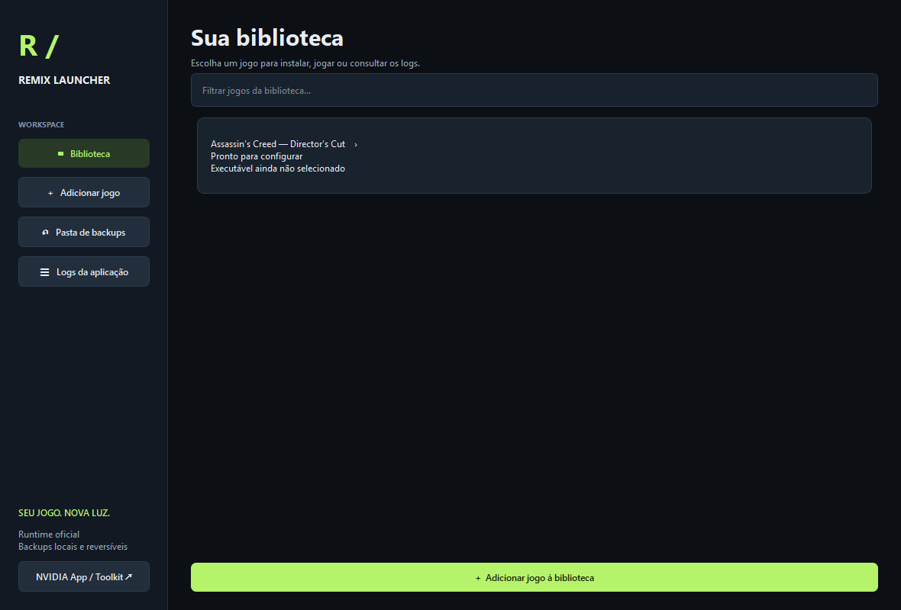

# RTX Remix Launcher

**[Baixar o executável mais recente](https://github.com/wesmagador/RemixLauncher/releases/latest)** · [Todas as versões](https://github.com/wesmagador/RemixLauncher/releases) · [Histórico de alterações](CHANGELOG.md)



Launcher local para Windows, em português, para instalar e remover o **runtime** RTX Remix em vários jogos. O primeiro perfil é Assassin’s Creed Director’s Cut (DX9). O Toolkit/editor é instalado separadamente pela NVIDIA App.

## Iniciar

**Versão pronta atualizada:** abra `dist/RemixLauncher-1.2.exe`. Usa Qt, com fundo opaco e download automático (seleciona somente o pacote release, sem símbolos ou builds debug). É um executável portátil e não exige Python instalado. Mantenha-o em uma pasta em que você possa gravar arquivos; os backups ficam na pasta `dados/` junto ao executável. Ao mover o launcher, leve também essa pasta.

## Biblioteca, descoberta e logs (1.2)

A tela inicial lista os jogos e permite filtrá-los por nome. Clique em um jogo para entrar nos controles de instalação, restauração, execução e diagnóstico; use Biblioteca para voltar. Os botões laterais têm texto centralizado.

Adicionar jogo abre opções de **Buscar instalados**, **Buscar em pasta** e **Escolher .exe manualmente**. A descoberta consulta bibliotecas Steam, manifests Epic, locais de instalação do registro e pastas comuns de jogos. A busca tem profundidade e quantidade de pastas limitadas, roda em segundo plano e pede que o usuário selecione os executáveis a cadastrar. Não instala nada, não executa arquivos encontrados e não comprova compatibilidade com Remix. Uma pasta de jogo já cadastrada não é duplicada.

Logs persistentes da aplicação ficam em `dados/logs/launcher.log` (rotação de até cinco arquivos de 2 MB). O botão lateral abre o visualizador. Cada jogo tem **Logs e diagnóstico**, que mostra os logs existentes na raiz, `.trex` e `rtx-remix/logs`, um resumo e exportação de texto local. A leitura mostra até os últimos 160 KB por arquivo. Clique Atualizar para reler. **Jogar com log detalhado** define `DXVK_LOG_LEVEL=debug` só para o processo do jogo; o runtime decide quais mensagens registrar. Não há upload automático de relatórios.

AC1: os logs observados nesta máquina continham mensagens de câmera inválida, fallback para rasterização e falha de swap chain. Não é possível atribuir todos os artefatos a uma só mensagem. O visualizador traz uma sequência de comparação e referências; não aplica configurações experimentais automaticamente. Uma captura de tela do defeito dentro da cena jogável ajuda a separar ruído de iluminação, UI e geometria.

O ícone é incluído como recurso do EXE, ícone da aplicação e da janela. O Windows recebe um AppUserModelID para agrupar as janelas. Atalhos antigos fixados podem continuar usando o ícone em cache: desafixe o antigo e fixe o EXE 1.2.

**Código-fonte atual:** execute `python qt_launcher.py`, com PySide6-Essentials instalado em `vendor/` e Python 3.11 ou superior. Para recompilar use `Compilar EXE.bat`, com PyInstaller instalado. O spec fixa as DLLs MSVC usadas pelo Qt e o ICU do Windows para evitar capturar bibliotecas incompatíveis do PATH da máquina de compilação. As interfaces Tk anteriores permanecem apenas como fontes legadas.

Para preparar uma cópia obtida do GitHub no Windows:

```powershell
python -m pip install --target vendor -r requirements.txt
python -m pip install -r requirements-build.txt
python qt_launcher.py
```

Para gerar o executável, execute `Compilar EXE.bat`. O resultado fica em `dist/RemixLauncher-1.2.exe`. O repositório contém o código-fonte, o ícone e as imagens da interface; downloads do runtime, jogos, backups, relatórios locais e dependências instaladas não são versionados. O arquivo `RemixLauncher-1.1.spec` mantém esse nome histórico, mas gera a versão 1.2.

1. Feche o jogo e selecione seu executável. Para AC1, use `AssassinsCreed_Dx9.exe`.
2. Clique em **Baixar e instalar**, que consulta a release mais recente do repositório oficial NVIDIA e escolhe o pacote x86/x64 pela arquitetura do executável. Alternativamente use **Importar ZIP** com um pacote completo oficial.
3. Aguarde a criação do backup e a instalação. Em pastas protegidas, use uma cópia do jogo em um diretório com permissão de escrita.
4. Clique em **Jogar** e teste Alt + X. A configuração do jogo, seleção de texturas da interface e captura de cenas continuam sendo feitas dentro do Remix.
5. Para desfazer, feche o jogo e clique em **Restaurar backup**. Restaure antes de instalar uma versão diferente.

## Backups

Os dados ficam em `dados/`, ao lado do launcher. Cada instalação salva em `dados/backups/<perfil>/<data-id>/` os arquivos anteriores e um manifesto com hashes SHA-256. O backup de todos os arquivos afetados termina antes da primeira escrita no jogo. Uma falha de cópia dispara reversão automática; se a reversão falhar, o manifesto permanece disponível para tentar restaurar novamente.

A restauração recupera arquivos sobrescritos e remove os arquivos adicionados pelo pacote. Pastas criadas só são removidas se vazias. Capturas e arquivos que não constam do pacote são preservados. Antes de restaurar, os arquivos atuais afetados também são copiados para `antes-de-restaurar`. Não apague nem mova `dados/` enquanto precisar de seus backups. Se mover o jogo, devolva-o ao caminho original para restaurar.

É um backup dos **arquivos afetados pelo runtime**, não do jogo inteiro ou dos saves. Runtime/configurações que já existiam serão recuperados ao restaurar. Feche outros launchers e instâncias deste programa durante instalações. Não encerre o processo durante operações. O launcher não detecta processos do jogo nem eleva privilégios automaticamente.

## Compatibilidade

Instalar não torna qualquer jogo compatível. O perfil AC1 é experimental: o registro comunitário antigo mostra que Remix conecta ao jogo, mas relata falhas de geometria e captura. Use uma cópia da instalação para experimentar. O launcher não aplica patches de shaders, não instala traduções de DX10/DX11 e não modifica executáveis.

Fontes: [runtime oficial](https://github.com/NVIDIAGameWorks/rtx-remix/releases), [instalação NVIDIA](https://docs.omniverse.nvidia.com/kit/docs/rtx_remix/latest/docs/installation/install-runtime.html), [Toolkit](https://docs.omniverse.nvidia.com/kit/docs/rtx_remix/latest/docs/installation/install-toolkit.html), [registro AC1](https://www.moddb.com/games/assassins-creed).

## Verificação

`python -m unittest -v test_launcher_ui.py test_remix.py` verifica navegação, opções do menu, descoberta, cadastro sem duplicação, persistência dos logs, diagnóstico, restauração, preservação de capturas e edições, reversão após falha de instalação, backup corrompido e bloqueio de ZIP com caminhos fora do destino. Não constitui validação de renderização no AC1.
